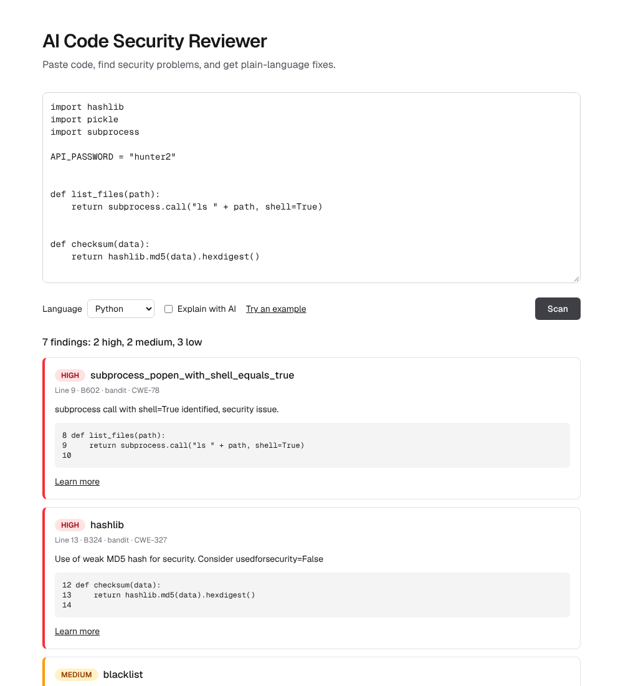
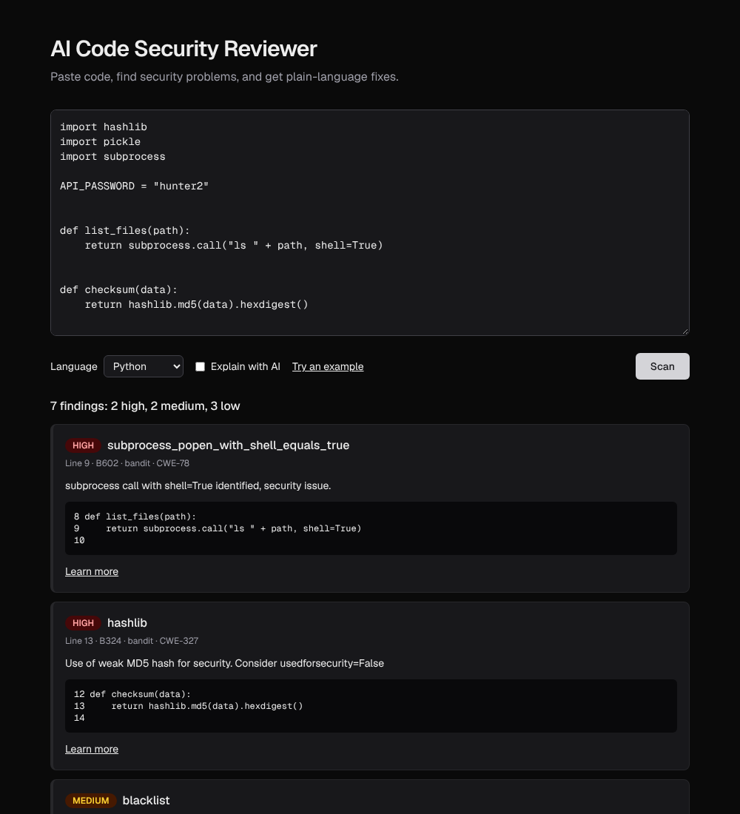

# AI Code Security Reviewer

[](https://github.com/RashniAthapattu/ai-code-security-reviewer/actions/workflows/ci.yml)

A web app that scans source code for security problems and uses AI to explain each one in plain language and suggest a fix.

Paste Python, JavaScript or TypeScript, press **Scan**, and get colour-coded findings. Tick **Explain with AI** to see what each problem means, how it could be abused, and a suggested fix.

## Screenshots

Scanning the built-in Python example (light and dark mode follow your device):





## Features

- **Two scanners:** Bandit for Python, and Semgrep with custom rules for JavaScript and TypeScript
- **AI explanations** (optional): Claude explains each finding, suggests a fix, and flags likely false alarms
- **Safe by design:** the code you submit is only read, never run, and it is treated as untrusted data when sent to the AI (a guard against prompt injection)
- **Works without AI:** with no API key, you still get the scanner results
- **Web interface:** severity colours, code lines, CWE numbers and example snippets to try

## Tech stack

| Area     | Tools |
|----------|-------|
| Backend  | Python 3.11+, FastAPI, Bandit, Semgrep |
| AI       | Anthropic Claude API |
| Frontend | Next.js, TypeScript, Tailwind CSS |
| Tests    | pytest, Vitest, Ruff |

## Run it locally

You need Python 3.11 or newer and Node.js 20 or newer.

### 1. Backend

```bash
cd backend
python3 -m venv .venv
source .venv/bin/activate
pip install -e ".[dev]"
uvicorn app.main:app --reload
```

The API runs on http://localhost:8000. Interactive docs are at http://localhost:8000/docs.

### 2. Frontend (in a second terminal)

```bash
cd frontend
npm install
npm run dev
```

Open http://localhost:3000.

### 3. Turn on AI explanations (optional)

Set your Anthropic API key before starting the backend:

```bash
export ANTHROPIC_API_KEY=your-key-here
```

The key is read from the environment and is never stored in the project. To try the AI from the command line:

```bash
cd backend
python -m scripts.try_explain samples/vulnerable.py
```

### Settings

| Variable | Where | Meaning |
|----------|-------|---------|
| `ANTHROPIC_API_KEY` | backend | Enables AI explanations |
| `ANTHROPIC_MODEL` | backend | Which Claude model to use (default `claude-opus-5-5`) |
| `MAX_EXPLAINED_FINDINGS` | backend | Most findings sent to the AI per scan (default 20) |
| `RATE_LIMIT_PER_HOUR` | backend | Scans per visitor per hour (default 60, 0 = no limit) |
| `AI_RATE_LIMIT_PER_HOUR` | backend | AI explanations per visitor per hour (default 10, 0 = no limit) |
| `AI_MAX_CODE_LENGTH` | backend | Longest code sent to the AI, in characters (default 20000) |
| `ALLOWED_ORIGINS` | backend | Websites allowed to call the API, comma-separated (default `http://localhost:3000`) |
| `NEXT_PUBLIC_API_URL` | frontend | Address of the API (default `http://localhost:8000`) |

## Run the tests

```bash
cd backend && pytest        # scanners, API, AI layer (AI calls are mocked)
cd frontend && npm test     # API client and helpers
```

## Host it yourself

To put it online, the website can run on Vercel and the API on Fly.io.

**1. API on Fly.io**

You need a Fly.io account (it asks for a card) and the `flyctl` command line tool.

```bash
cd backend
fly auth login
fly launch --no-deploy --copy-config   # say no to databases; change the app name if it is taken
fly secrets set ANTHROPIC_API_KEY=your-key-here
fly deploy
fly scale count 1                      # one machine keeps the rate limits accurate
```

Then open `https://<your-app>.fly.dev/health`. It should show `{"status":"ok"}`.

**2. Website on Vercel**

1. In Vercel, choose **Add New > Project** and import this repository.
2. Set **Root Directory** to `frontend`.
3. Add the environment variable `NEXT_PUBLIC_API_URL` with the Fly address from step 1 (no trailing slash).
4. Deploy, then tell the API about the website: `fly secrets set ALLOWED_ORIGINS=https://your-app.vercel.app` (run in `backend`).

**Protecting the demo.** Each visitor gets 60 scans and 10 AI explanations per hour, and code over 20,000 characters is not sent to the AI (see the settings table). Also set a monthly spend limit in the Anthropic console. The API machine sleeps when idle to save money, so the first scan after a quiet period can take several seconds. Expect a small monthly bill (a few dollars) for the 1 GB machine.

## How it works

1. The website sends the code to `POST /scan`.
2. The backend writes it to a temporary file and analyses it statically with Bandit or Semgrep. It is never executed.
3. If AI is requested, the findings and code are sent to Claude with clear boundaries marking the code as untrusted. The reply is checked and shortened before it is returned.
4. If the AI is missing or fails, the scan results are returned anyway, with a notice.

## Project structure

```
backend/    FastAPI app, scanners, AI explainer, Dockerfile, Fly.io setup, tests
frontend/   Next.js website
```
